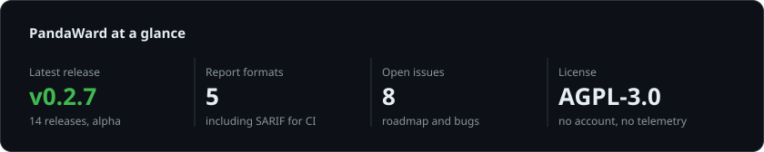

<picture>
  <source media="(prefers-color-scheme: light)" srcset="assets/header-light.svg">
  
</picture>

<p>
  <a href="https://linkedin.com/in/ratomir"></a>
  <a href="https://x.com/heyratomir"></a>
</p>

I have spent 18 years building software across SaaS, fintech and payments, much of it in regulated, audited and security-sensitive environments. Today most of my open-source time goes into [PandaWard](https://github.com/ratomirjovanovic/pandaward), a local application security assessment engine that keeps evidence for every finding and says plainly what it did not test. Alongside it I build payment infrastructure at Payshen, maintain tooling for payment developers and review payment, webhook and auth code in other projects.

## Now

| Venture | Role and focus |
| --- | --- |
| **[PandaWard](https://github.com/ratomirjovanovic/pandaward)** | Maintainer, main open-source project. Local, evidence-based application security assessment as a Go CLI and a Claude Code plugin. |
| **[Payshen](https://www.payshen.com)** | Founder and Managing Director. Payment orchestration: every provider through one integration, each payment routed to the provider most likely to approve it, retried elsewhere only when that is safe, with the reason recorded. |
| **[PandaPayLens](https://github.com/ratomirjovanovic/PandaPayLens)** | Maintainer. Open-source, local-first payment error decoder and transaction timeline visualizer. |
| **[afend](https://afend.com)** | Founder. Guided ISO/IEC 27001:2022 readiness, from risk register to an auditor-ready handoff. |
| **[Nanotesting](https://nanotesting.com)** | Founder. Automated security assessment for websites, APIs and repositories. |
| **[SodaSoft](https://sodasoft.com)** | Founder. Venture studio for software products: design, engineering and launch. |

## Open source

### [PandaWard](https://github.com/ratomirjovanovic/pandaward)

Application security assessment for your own repositories that also tells you what it did not test. Most scanners print alerts and stop; PandaWard keeps a ledger of every control it could check, how it checked it and the redacted evidence, and lists every control it could not decide. Passive by default, network tests only after a person approves the scope. Formerly PenSec, renamed in 0.2.0.

<a href="https://ratomirjovanovic.github.io/pandaward/demo/">
  <picture>
    <source media="(prefers-color-scheme: dark)" srcset="https://raw.githubusercontent.com/ratomirjovanovic/pandaward/main/docs/media/findings-dark.png">
    
  </picture>
</a>

- **Honest coverage:** only PASS and FAIL are decisive; blocked, unsupported or suspected controls never count as secure.
- **Evidence, not opinions:** each finding links to a redacted, SHA-256 addressed evidence record and is fingerprinted across runs, so a fix counts only when the check runs again.
- **No AI-confirmed findings:** review agents can only record hypotheses, and the engine reads and redacts the cited lines itself.
- **Wide static coverage:** secrets, injection sinks, CI/CD, containers, Terraform, Android and iOS manifests, webhooks, MCP and LLM output reaching exec sinks.
- **Reports and CI:** HTML, Markdown, JSON, SARIF 2.1.0 and CSV, with a `--fail-on` gate. Release binaries are reproducible, with checksums, an SBOM and signed provenance.

```text
/plugin marketplace add ratomirjovanovic/pandaward
/plugin install pandaward@pandaward            # macOS and Linux
/plugin install pandaward-windows@pandaward    # Windows
/pandaward:scan
```

[Live demo](https://ratomirjovanovic.github.io/pandaward/demo/) · [Website](https://ratomirjovanovic.github.io/pandaward/) · [Docs](https://github.com/ratomirjovanovic/pandaward/wiki) · [Quick start](https://github.com/ratomirjovanovic/pandaward#quick-start) · [Releases](https://github.com/ratomirjovanovic/pandaward/releases) · [Roadmap](https://github.com/ratomirjovanovic/pandaward#roadmap)

### [PandaPayLens](https://github.com/ratomirjovanovic/PandaPayLens)

Paste an API response, webhook or postback and see what the provider reported, what the code means, which events belong together and what looks wrong. Nothing leaves the browser.

<a href="https://ratomirjovanovic.github.io/PandaPayLens/media/pandapaylens-demo.mp4">
  
</a>

- **Deterministic analysis:** structural provider detection, documented error catalogs, correlation by explicit identifiers and explainable diagnostic rules.
- **Wide coverage:** card processors, wallets, pay-by-bank, crypto and high-risk billing providers, each with an honest capability manifest.
- **Privacy by design:** sensitive data redacted from everything shown or exported, identifiers masked, strict Content Security Policy, no server-side processing.
- **Three ways to run it:** a static demo, an offline CLI and a Next.js app with a passkey-protected admin area.

[Live demo](https://ratomirjovanovic.github.io/PandaPayLens/) · [Demo video (1 min)](https://ratomirjovanovic.github.io/PandaPayLens/media/pandapaylens-demo.mp4) · [Docs](https://github.com/ratomirjovanovic/PandaPayLens/wiki) · [Releases](https://github.com/ratomirjovanovic/PandaPayLens/releases) · [Roadmap](https://github.com/ratomirjovanovic/PandaPayLens/blob/main/ROADMAP.md) · [Good first issues](https://github.com/ratomirjovanovic/PandaPayLens/labels/good%20first%20issue)

### Payshen SDKs

Official client libraries for the [Payshen](https://www.payshen.com) payment orchestration API: payments, captures, voids, refunds, events and webhook verification. Published and maintained on four registries.

<a href="https://www.npmjs.com/package/@payshen/sdk"></a>
<a href="https://pypi.org/project/payshen/"></a>
<a href="https://packagist.org/packages/payshen/payshen-php"></a>
<a href="https://wordpress.org/plugins/payshen-for-woocommerce/"></a>

[PHP](https://github.com/meetsodasoft/payshen-php) · [Python](https://github.com/meetsodasoft/payshen-python) · [WooCommerce](https://github.com/meetsodasoft/payshen-woocommerce)

### Code reviews in other projects

Recent public reviews, mostly payment, webhook and security changes. The last column shows what GitHub recorded after the review: whether the author pushed changes, whether I approved, and whether the pull request was merged.

<!-- reviews:start -->
<sub>20 pull requests in 16 projects · 9 revised by their authors after the review · 7 merged</sub>

| Project | Pull request reviewed | Since the review |
| --- | --- | --- |
| [standard-webhooks/standard-webhooks](https://github.com/standard-webhooks/standard-webhooks) | [#348](https://github.com/standard-webhooks/standard-webhooks/pull/348) Sign binary payloads byte for byte (JavaScript, Python) | Merged after revision |
| [paypal/paypal-js](https://github.com/paypal/paypal-js) | [#1100](https://github.com/paypal/paypal-js/pull/1100) fix(paypal-js): only reuse a pending v6 script for the same namespace | Revised after review |
| [modelcontextprotocol/go-sdk](https://github.com/modelcontextprotocol/go-sdk) | [#1451](https://github.com/modelcontextprotocol/go-sdk/pull/1451) auth/extauth: send resource in client credentials token requests | Merged after revision |
| [juspay/hyperswitch-web](https://github.com/juspay/hyperswitch-web) | [#1829](https://github.com/juspay/hyperswitch-web/pull/1829) fix: preserve 3DS messages before closing fullscreen frames | Merged |
| [DataDog/dd-trace-js](https://github.com/DataDog/dd-trace-js) | [#10932](https://github.com/DataDog/dd-trace-js/pull/10932) fix(appsec): wrap shared Stripe webhooks methods only once | Open |
| [medusajs/medusa](https://github.com/medusajs/medusa) | [#17538](https://github.com/medusajs/medusa/pull/17538) fix(medusa): reject webhooks for nonexistent providers | Merged |
| [payloadcms/payload](https://github.com/payloadcms/payload) | [#19024](https://github.com/payloadcms/payload/pull/19024) fix(plugin-ecommerce): drop cart items from Stripe payment intent metadata | Closed |
| [Adyen/adyen-web](https://github.com/Adyen/adyen-web) | [#4273](https://github.com/Adyen/adyen-web/pull/4273) Fix/prevent duplicate 3DS2 challenge completion | Merged after revision |
| [better-auth/better-auth](https://github.com/better-auth/better-auth) | [#12049](https://github.com/better-auth/better-auth/pull/12049) fix(account): share and guard concurrent provider token refreshes | Revised after review |
| [anthropics/anthropic-sdk-typescript](https://github.com/anthropics/anthropic-sdk-typescript) | [#1284](https://github.com/anthropics/anthropic-sdk-typescript/pull/1284) fix(client): keep the abort listener while the Response is held | Open |
| [mark3labs/mcp-go](https://github.com/mark3labs/mcp-go) | [#1123](https://github.com/mark3labs/mcp-go/pull/1123) fix(oauth): refresh an access token shortly before it expires | Open |
| [razorpay/razorpay-node](https://github.com/razorpay/razorpay-node) | [#495](https://github.com/razorpay/razorpay-node/pull/495) fix(security): use constant-time comparison for webhook signature validation... | Revised, then approved |
<!-- reviews:end -->

### Issues raised in other projects

Problems I found while integrating or reviewing other projects, reported upstream.

<!-- issues:start -->
| Project | Issue | Status |
| --- | --- | --- |
| [getlago/lago](https://github.com/getlago/lago) | [#842](https://github.com/getlago/lago/issues/842) \[BUG\]: No private way to report a security issue on GitHub | Open |
| [svix/svix-webhooks](https://github.com/svix/svix-webhooks) | [#2763](https://github.com/svix/svix-webhooks/issues/2763) php: Webhook accepts an empty or non-base64 secret and verifies with an empty... | Fixed |
| [Adyen/adyen-node-api-library](https://github.com/Adyen/adyen-node-api-library) | [#1816](https://github.com/Adyen/adyen-node-api-library/issues/1816) \[Bug\]: HmacValidator accepts a malformed HMAC key as an empty key | Open |
| [golang/go](https://github.com/golang/go) | [#82658](https://github.com/golang/go/issues/82658) x/oauth2: DeviceAccessToken panics on a negative or very large interval | Open |
| [medusajs/medusa](https://github.com/medusajs/medusa) | [#17544](https://github.com/medusajs/medusa/issues/17544) \[Bug\]: Payment providers removed from config are never disabled in payment_pr... | Fixed |
| [juspay/hyperswitch-web](https://github.com/juspay/hyperswitch-web) | [#1831](https://github.com/juspay/hyperswitch-web/issues/1831) 3DS authentication: a failed auth call falls through to the frictionless submit | Open |
| [payloadcms/payload](https://github.com/payloadcms/payload) | [#19055](https://github.com/payloadcms/payload/issues/19055) plugin-ecommerce: restore the Stripe cart drift check with a metadata digest,... | Open |
| [supabase/ssr](https://github.com/supabase/ssr) | [#209](https://github.com/supabase/ssr/issues/209) tsconfig.json: outDir without rootDir triggers TS6059 / migration warning whe... | Fixed |
<!-- issues:end -->

## Project facts

<picture>
  <source media="(prefers-color-scheme: light)" srcset="assets/activity-light.svg">
  
</picture>

<sub>This card and the review list above are generated daily from public GitHub data. My contribution activity is GitHub's own overview, below this README.</sub>

## What I work on

| Area | Focus |
| --- | --- |
| Payments and fintech | PSP integrations, orchestration and routing, decline and error semantics, webhooks, settlement and reconciliation |
| Application security | Static analysis and evidence-based assessment, secrets handling, CI/CD and supply chain, webhook and auth review |
| GRC | ISO/IEC 27001 readiness, risk and supplier management, control evidence, secure design |
| Engineering | TypeScript, Go and Python services, API clients and SDKs, testing and CI, documentation that matches the code |

### Toolbox

| Area | Tools |
| --- | --- |
| **Languages** |  |
| **Frameworks** |  |
| **Data and cloud** |   |
| **Delivery** |  |
